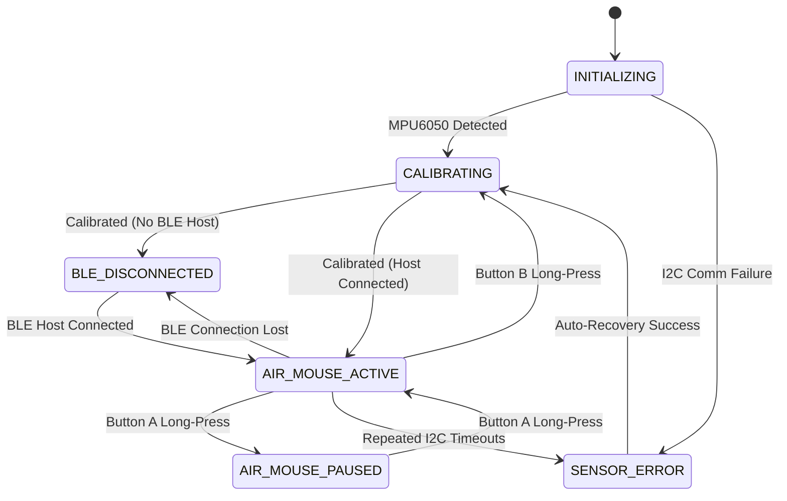

# ESP32-S3 Air Mouse Prototype V1 — Production Firmware

A production-grade, modular firmware implementation for a handheld BLE HID Air Mouse built on the **ESP32-S3 Super Mini**, featuring an **MPU6050 6-axis IMU**, tactile button management, a dedicated safety-interlocked laser diode driver, and real-time USB CDC telemetry.

---

## 1. Project Overview & Architecture

The firmware is designed with strict separation of concerns, deterministic non-blocking timing, and fail-safe hardware defaults.

```
sentinal/
├── platformio.ini              # PlatformIO environment, build flags, and pinned dependencies
├── wiring.md                   # Complete electrical diagrams, pinout table, and driver schematics
├── README.md                   # System documentation, user guide, and testing protocol
└── src/
    ├── main.cpp                # Executive lifecycle and non-blocking event dispatcher
    ├── config/
    │   ├── pins.h              # Centralized GPIO allocations with validation notes
    │   └── settings.h          # Centralized operational settings and tunable parameters
    ├── sensors/
    │   ├── imu_driver.h        # Direct high-speed I2C register driver for MPU6050
    │   ├── imu_driver.cpp      # Burst reads (14-byte), dual-address probing, bus recovery
    │   ├── imu_calibration.h   # Zero-rate gyro bias estimation and motion detection
    │   └── imu_calibration.cpp # Stationary variance analysis and offset calculation
    ├── input/
    │   ├── button_manager.h    # Tactile button state machine and gesture classifier
    │   └── button_manager.cpp  # Software debouncing (25ms), chording, long-press separation
    ├── motion/
    │   ├── motion_processor.h  # Rate-to-cursor displacement engine
    │   └── motion_processor.cpp# Deadzone ramp, IIR filtering, sub-pixel accumulator, acceleration
    ├── connectivity/
    │   ├── ble_mouse.h         # NimBLE HID mouse server interface
    │   └── ble_mouse.cpp       # HID mouse descriptors, report dispatcher, auto-reconnection
    ├── peripherals/
    │   ├── laser_controller.h  # Safety-conscious laser diode controller
    │   └── laser_controller.cpp# 5-second hard timeout, interlocks, hardware auditing
    └── system/
        ├── state_manager.h     # 7-state deterministic system FSM
        ├── state_manager.cpp   # Transition validation and safety observers
        ├── diagnostics.h       # USB CDC serial telemetry and command interface
        └── diagnostics.cpp     # Startup banner, register logging, heartbeat, debug streaming
```

---

## 2. Hardware Bill of Materials & Pin Assignments

| Component | Function | ESP32-S3 Super Mini Pin | Notes |
|:----------|:---------|:------------------------|:------|
| **MPU6050 IMU** | I2C Data (`SDA`) | **GPIO8** | Right header, 400 kHz Fast-Mode |
| **MPU6050 IMU** | I2C Clock (`SCL`) | **GPIO9** | Right header |
| **Button A** | Left-Click / Pause | **GPIO5** | Left header, active-LOW (`INPUT_PULLUP` to GND) |
| **Button B** | Right-Click / Recalib / Laser | **GPIO6** | Left header, active-LOW (`INPUT_PULLUP` to GND) |
| **Laser Driver** | Driver Gate/Base | **GPIO7** | Left header, active-HIGH through 220 Ω to MOSFET |
| **Power** | 3.3 V Logic Rail | **3V3** | Powers MPU6050 logic |
| **Ground** | Common Return | **GND** | Star-ground reference |

*(Refer to [wiring.md](file:///e:/Downloads/sentinal/wiring.md) for full electrical schematics and transistor/MOSFET driver circuits).*

---

## 3. Development Environment & Build Configuration

- **IDE:** Visual Studio Code with PlatformIO Extension
- **MCU:** Espressif ESP32-S3 (Xtensa Dual-Core LX7 @ 240 MHz)
- **Framework:** Arduino-ESP32 (`framework-arduinoespressif32 @ 3.1.3` / ESP-IDF 5.3)
- **BLE Stack:** `h2zero/NimBLE-Arduino @ ^1.4.2`
  - High-efficiency BLE stack (~150 KB lower flash consumption than Bluedroid).
  - Native HID service implementation with fast reconnection.
- **Native USB CDC:** Enabled via `-DARDUINO_USB_CDC_ON_BOOT=1` and `-DARDUINO_USB_MODE=1` to provide seamless serial diagnostics directly over the board's USB-C port.

### `platformio.ini`
```ini
[env:esp32-s3-devkitc-1]
platform = espressif32
board = esp32-s3-devkitc-1
framework = arduino
monitor_speed = 115200
build_flags = 
    -DARDUINO_USB_CDC_ON_BOOT=1
    -DARDUINO_USB_MODE=1
lib_deps = 
    h2zero/NimBLE-Arduino @ ^1.4.2
```

---

## 4. Key Functional Subsystems

### A. Motion Processing Pipeline

Unlike basic implementations that map raw accelerometer gravity to mouse position (which suffers from tilt lock and severe drift), the V1 motion pipeline is powered directly by calibrated **angular velocity (gyro rate)**:

1. **Dual-Address I2C Acquisition (100 Hz):**
   - Fast 14-byte burst read of accelerometer, temperature, and gyro registers in ~350 µs.
   - Automatically probes primary address `0x68` (AD0 = GND) and secondary `0x69` (AD0 = 3.3V).
2. **Stationary Bias Correction:**
   - 2-second initial bias calibration removes zero-rate offset ($\text{rate} - \text{offset}$).
3. **Deadzone Ramp:**
   - Angular velocities below $1.25^\circ/\text{s}$ are suppressed to zero.
   - Velocities above $1.25^\circ/\text{s}$ ramp smoothly without a sudden step jump.
4. **First-Order IIR Smoothing:**
   - Low-pass filter ($\alpha = 0.45$) attenuates high-frequency hand tremors.
5. **Velocity-Based Cursor Acceleration:**
   - Above $22^\circ/\text{s}$, a quadratic multiplier accelerates the cursor for fast screen traversal.
6. **Sub-Pixel Fractional Accumulation:**
   - Retains fractional pixels across frames, ensuring micro-movements are never truncated or lost.

### B. Finite State Machine (FSM)

The system operates under an explicit 7-state FSM managed by [state_manager.cpp](file:///e:/Downloads/sentinal/src/system/state_manager.cpp):



### C. Button Gestures (V1 Mapping)

- **Button A (Short Press):** Left-Click (emitted on release if $< 750\text{ ms}$).
- **Button B (Short Press):** Right-Click (emitted on release if $< 750\text{ ms}$).
- **Button A (Long Press $\ge 750\text{ ms}$):** Toggles **Air Mouse Motion Pause / Resume**.
  - Allows repositioning the physical hand in the air without displacing the on-screen cursor (re-centering).
- **Button B (Long Press $\ge 750\text{ ms}$):** Initiates **Stationary Gyro Recalibration**.
- **Button B (Double-Tap & Hold):** Activates the **Laser Diode**.
  - Tap once, press again within 300 ms, and hold -> Laser stays ON.
  - Releasing Button B immediately switches laser OFF.
- **Both Buttons Held Simultaneously:** Chorded combination reserved for future V2 modes. Does not trigger clicks or laser.

### D. Laser Safety Interlocks

1. **Hardware Failsafe:** Mandatory 10 kΩ pull-down resistor on MOSFET gate guarantees laser is OFF during MCU reset, boot, and brownout.
2. **Software Initialization:** GPIO7 is driven `LOW` as the first instruction in `setup()`.
3. **Hard Timeout:** If continuously held, the laser automatically cuts OFF after **5.0 seconds** (`LASER_MAX_ON_TIME_MS`).
4. **Mandatory Cooldown:** Following a timeout, the user must release the button and wait **1.0 second** before re-activation.
5. **State Interlock:** The laser is unconditionally inhibited in `SENSOR_ERROR`, `BLE_DISCONNECTED`, and `CALIBRATING` states.
6. **Continuous Hardware Audit:** Every loop iteration audits the physical pin against the logic state.

---

## 5. Build, Flash, and Setup Instructions

### Prerequisites
1. Install [VS Code](https://code.visualstudio.com/).
2. Install the **PlatformIO IDE** extension from the VS Code Marketplace.
3. Connect the ESP32-S3 Super Mini to your PC using a high-quality USB-C data cable.

### Compilation & Flashing
1. Open this project folder (`sentinal`) in VS Code.
2. PlatformIO will automatically parse `platformio.ini` and download required toolchains and `NimBLE-Arduino`.
3. Open the PlatformIO terminal and run:
   ```bash
   # Compile project
   pio run

   # Upload firmware to ESP32-S3
   pio run --target upload

   # Open USB Serial Monitor (115200 baud)
   pio device monitor
   ```

> [!NOTE]
> If your ESP32-S3 fails to enter upload mode automatically:
> 1. Press and hold the **BOOT** button on the Super Mini.
> 2. Press and release the **RESET** button.
> 3. Release the **BOOT** button.
> 4. Trigger the upload again.

---

## 6. Windows BLE Pairing & Troubleshooting

1. Open **Windows Settings** -> **Bluetooth & devices** -> **Add device**.
2. Select **Bluetooth**.
3. Locate **`S3 Air Mouse V1`** in the list and click to pair.
4. Windows will configure the device as an input peripheral (*"Mouse, keyboard & pen"*).
5. Open the Serial Monitor in VS Code. You will observe:
   ```
   [BLE] Device connected to Host PC! HID reports active.
   [STATE] Transition: BLE_DISCONNECTED -> AIR_MOUSE_ACTIVE
   ```

### Troubleshooting
- **Device does not appear in scan:** Verify that no other PC or phone has bonded with it. If needed, press Button B long-press to reset.
- **Mouse cursor is drifting when held still:** Place the device on a flat, stable desk and perform a long press on Button B (or send `'r'` via serial monitor) to calibrate zero-rate bias.
- **Laser turns off while holding:** This is the intentional 5-second safety cutoff preventing accidental eye exposure or thermal runaway.

---

## 7. Interactive Serial Diagnostic Commands

Connect a serial terminal at **115200 baud** to access real-time diagnostics:

| Command | Action | Description |
|:--------|:-------|:------------|
| `'d'` or `'D'` | Toggle Motion Stream | Toggles live ASCII telemetry of gyro rates and HID `dx`/`dy` deltas. |
| `'r'` or `'R'` | Recalibrate Gyro | Triggers a 2-second stationary bias calibration routine. |
| `'h'` or `'H'` | Help | Displays interactive command options and firmware status. |

---

## 8. Functional Acceptance & Testing Checklist

| Test # | Description | Execution Procedure | Pass Criteria |
|:-------|:------------|:--------------------|:--------------|
| **T01** | Firmware Build | Execute `pio run` in clean workspace. | Exits with code 0; zero compilation errors or warnings. |
| **T02** | Sensor Detection | Boot with MPU6050 attached at 0x68 and 0x69. | Log prints correct address and WHO_AM_I register value (0x68). |
| **T03** | Stationary Calibration | Keep device still on desk during boot. | Calibration completes with $< 0.1^\circ/\text{s}$ noise and valid offsets. |
| **T04** | Motion-Disturbed Calib | Gently shake device during calibration. | Log detects motion, rejects bad offsets, and keeps prior values. |
| **T05** | BLE Pairing | Add device in Windows Bluetooth settings. | Pairs as `S3 Air Mouse V1` without PIN requirement. |
| **T06** | Cursor Movement | Rotate wrist in pitch and yaw directions. | Cursor translates smoothly in X and Y on host PC. |
| **T07** | Stationary Drift | Leave device stationary on mousepad for 60s. | Host cursor exhibits zero pixel jitter or drift. |
| **T08** | Left-Click | Short tap on Button A ($< 750\text{ ms}$). | Left-click event received by OS; no cursor stutter. |
| **T09** | Right-Click | Short tap on Button B ($< 750\text{ ms}$). | Context menu opens on host OS after 300 ms double-click window. |
| **T10** | Motion Pause | Long press Button A ($\ge 750\text{ ms}$). | State shifts to `AIR_MOUSE_PAUSED`; cursor stops moving while repositioning. |
| **T11** | Recalibration | Long press Button B ($\ge 750\text{ ms}$). | Calibration re-executes; log confirms updated offsets. |
| **T12** | Laser Activation | Double-tap and hold Button B. | Laser turns ON immediately on second press and remains lit while held. |
| **T13** | Laser Release | Release Button B from double-tap hold. | Laser turns OFF instantly with zero afterglow. |
| **T14** | Laser Safety Timeout | Hold laser activation for $> 5.0\text{ s}$. | Laser turns OFF automatically at 5000 ms; cooldown enforced. |
| **T15** | BLE Disconnect Safety | Disable Bluetooth on host PC while laser held. | State transitions to `BLE_DISCONNECTED`; laser forced OFF immediately. |

---

## 9. Future V2 Extensibility Path

The firmware architecture is prepared for the following V2 enhancements without refactoring core components:

1. **Presentation Mode:**
   - Dedicated navigation mode where Button A sends HID Keycode `PAGE_UP` (Previous slide) and Button B sends `PAGE_DOWN` (Next slide).
2. **Auto-Reel Scrolling:**
   - Automatic vertical scrolling via periodic HID wheel reports triggered by wrist flick gestures.
3. **USB HID Dual-Mode:**
   - Using ESP32-S3's native USB hardware to provide plug-and-play wired USB mouse operation when Bluetooth is unavailable.
